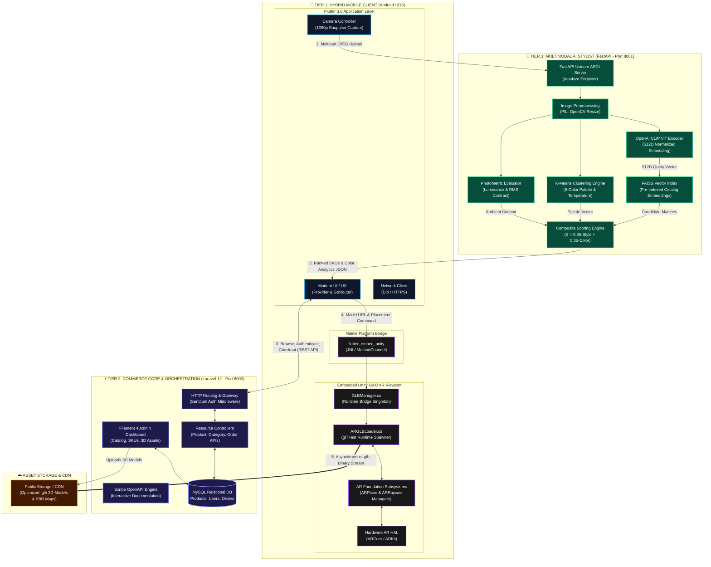
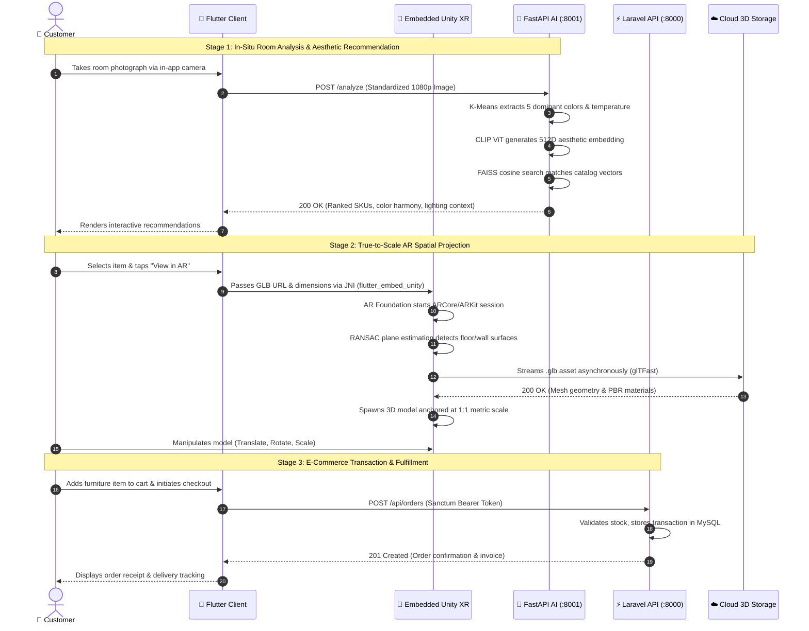
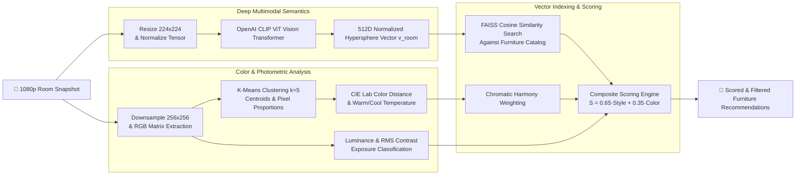

# 🛋️ Mirage: AI-Powered Augmented Reality Smart Furniture Store

<p align="center">
  <strong>An Intelligent Spatial Commerce Ecosystem Combining Unity XR, Flutter, Laravel 12, and Multimodal CLIP AI.</strong>
</p>

<p align="center">
  <a href="#-system-architecture"></a>
  <a href="#-frontend-flutter-mobile-app"></a>
  <a href="#-unity-ar-engine"></a>
  <a href="#-backend-laravel-12--filament"></a>
  <a href="#-ai-microservice-fastapi--clip"></a>
  <a href="docs/Mirage_Project_Documentation.pdf"></a>
</p>

---

## 📌 Executive Summary

Online furniture e-commerce suffers from elevated return rates and customer hesitation caused by **spatial uncertainty** (will it physically fit?) and **aesthetic discord** (will it match the room's lighting, palette, and style?). 

**Mirage** bridges this divide by delivering an end-to-end, commercial-grade spatial e-commerce ecosystem. The system pairs **true-to-scale 1:1 Augmented Reality visualization** with an **in-situ Multimodal AI interior stylist**. Customers can capture a snapshot of their living space, receive real-time aesthetic and color-harmonic furniture recommendations via OpenAI CLIP and K-Means clustering, and immediately project photorealistic 3D furniture into their physical environment using phone-based AR before purchasing.

---

## ✨ Key System Features

- 📐 **True-to-Scale 1:1 AR Placement**: Built with **Unity XR** and **AR Foundation** (ARCore & ARKit). Implements surface tracking across both horizontal planes (floors, tables) and vertical planes (walls) with metric dimension scaling.
- 🔄 **Embedded Unity Viewport**: The Unity AR rendering engine is embedded directly inside the **Flutter** mobile application using `flutter_embed_unity`, creating zero-friction transitions between shopping catalog and spatial preview.
- 🎨 **Multimodal AI Interior Stylist**: A **FastAPI + PyTorch** microservice leveraging **OpenAI CLIP (ViT-B/32 / ViT-L/14)** and **FAISS** vector similarity search. Ingests static room snapshots to evaluate:
  - Dominant color palettes, temperature, warmth, and saturation via K-Means clustering.
  - Lighting levels, exposure, and scene contrast.
  - Room typology, structural composition, and architectural material classification.
  - Semantic catalog matching for harmonious furniture pairing in **< 2.0 seconds**.
- ☁️ **Dynamic 3D Asset Streaming**: 3D models (`.glb` / `.gltf`) stream on-demand from cloud storage into the AR scene via an asynchronous pipeline (`ARGLBLoader.cs`), preventing client APK bloat.
- 🛒 **Full-Featured Commerce Backend**: Engineered on **Laravel 12** with **Filament 4**, featuring an administrative control center for 3D model management, inventory tracking, order fulfillment, category hierarchies, and token-based **Sanctum** authentication.
- 📖 **Interactive OpenAPI Documentation**: Auto-generated API documentation and interactive test harnesses powered by **Scribe**.

---

## 🏗️ System Architecture

Mirage implements a decoupled, three-tier microservice architecture engineered to reconcile heavy computer vision inference and real-time 3D spatial computing with consumer mobile hardware:

1. **Presentation & Spatial Client**: Flutter 3.8+ cross-platform mobile app embedding a native Unity 6000 XR runtime via `flutter_embed_unity`.
2. **Commerce Core & Orchestration API**: Laravel 12 RESTful API with Filament 4 admin panel, Sanctum authentication, and MySQL relational persistence.
3. **Multimodal Machine Learning Microservice**: Python FastAPI ASGI server running OpenAI CLIP visual transformers, K-Means chromatic clustering, and FAISS vector indexing.



### 🔄 End-to-End Operational Sequence



### 🧠 Subsystem Deep-Dive: AI Recommendation Pipeline



### 🥽 Subsystem Deep-Dive: Unity AR Spatial Calibration Pipeline

```mermaid
flowchart LR
    A["📱 Monocular Camera<br>& IMU Sensors"] --> B["Feature Point Gradient Tracking<br>(ARCore / ARKit HAL)"]
    B --> C["Coplanar Surface Estimation<br>(RANSAC Algorithm)"]
    C --> D["Horizontal Floors & Vertical Walls Detection<br>(ARPlaneManager)"]
    D --> E["Screen-Space Touch Raycast<br>(ARRaycastManager)"]
    E --> F["Sub-Centimeter 3D World Anchor"]
    F --> G["Asynchronous Cloud .glb Download<br>(glTFast Runtime Loader)"]
    G --> H["PBR Shaders & Spherical Harmonics Lighting"]
    H --> I["🛋️ True-to-Scale 1:1 Metric Placement<br>& Real-Time Gesture Manipulation"]
```



---

## 📊 Technical Benchmarks & Evaluation

Empirically validated and documented in the official graduation thesis:

| Metric | Result | Target Benchmark | Status |
| :--- | :--- | :--- | :---: |
| **AR Rendering Frame Rate** | **34.8 – 36.2 FPS** | ≥ 30 FPS on mid-range devices | Passed |
| **Spatial Scale Accuracy** | **1:1 Metric Calibration** | Deviation < 3% of physical ground truth | Passed |
| **AI Inference Latency** | **1.74 seconds** (end-to-end) | ≤ 3.0 seconds per room analysis | Passed |
| **Plane Detection Speed** | **1.2 – 2.4 seconds** | Fast initial anchor acquisition | Passed |
| **3D GLB Download & Spawning** | **< 3.1 seconds** (avg 5MB model) | Asynchronous non-blocking runtime | Passed |

---

## 📂 Repository Structure

```
Mirage-AR-Furniture-Store/
├── frontend/                 # Flutter mobile client (Dart 3, Provider, GetIt, Dio)
│   ├── lib/                  # Screens, ViewModels, Services, Models
│   ├── android/              # Native Android host with embedded Unity library
│   ├── ios/                  # Native iOS host configuration
│   └── pubspec.yaml          # Flutter dependencies
│
├── backend/                  # Laravel 12 REST API & Filament 4 Admin Panel
│   ├── app/                  # Controllers, Models, Filament Resources
│   ├── database/             # Migrations, Factories, Seeders
│   ├── routes/api.php        # Secured API endpoints
│   └── composer.json         # PHP dependencies
│
├── ai-service/               # FastAPI Computer Vision & Style Recommendation Engine
│   ├── backend/              # main.py, analyzer.py, matcher.py
│   ├── data/                 # Furniture catalog metadata & embeddings
│   ├── requirements.txt      # PyTorch, CLIP, FAISS, FastAPI dependencies
│   └── FLUTTER_INTEGRATION_GUIDE.md
│
├── unity-ar/                 # Unity 6000 XR / AR Foundation Project
│   ├── Assets/Scripts/       # ARGLBLoader.cs, GLBManager.cs
│   ├── Assets/FlutterEmbed/  # Bridge scripts exporting Unity into Flutter
│   └── ProjectSettings/      # ARCore / ARKit XR plugin management
│
├── docs/                     # Academic documentation & thesis
│   └── Mirage_Project_Documentation.pdf
│
└── README.md                 # Flagship project documentation
```

---

## 🚀 Quickstart & Setup Guide

### 1. Prerequisites
- **Git**, **PHP 8.2+**, **Composer**, **Node.js 18+**
- **Python 3.10+** (with CUDA recommended if using GPU)
- **Flutter SDK 3.8+** & **Android Studio** (Android SDK 34+)
- **Unity 6000.0+ (Unity 6)** with Android Build Support & OpenJDK installed

---

### 2. Backend Setup (Laravel 12 API)
```bash
cd backend

# Install dependencies
composer install
npm install

# Environment configuration
cp .env.example .env
php artisan key:generate

# Database migration & seed initial catalog
php artisan migrate --seed

# Create storage symlink for uploaded 3D models and photos
php artisan storage:link

# Launch local development server
php artisan serve
```
* **API Server:** `http://localhost:8000`
* **Filament Admin Panel:** `http://localhost:8000/admin`
* **API Documentation:** `http://localhost:8000/docs` (generated via `php artisan scribe:generate`)

---

### 3. AI Service Setup (FastAPI & CLIP)
```bash
cd ai-service

# Create virtual environment
python -m venv venv
# Windows:
.\venv\Scripts\activate
# Linux/macOS:
source venv/bin/activate

# Install PyTorch and ML dependencies
pip install -r requirements.txt

# Start recommendation server
uvicorn backend.main:app --host 0.0.0.0 --port 8001 --reload
```
* **Interactive Swagger UI:** `http://localhost:8001/docs`
* **Health Check:** `http://localhost:8001/`

---

### 4. Mobile Client Setup (Flutter)
```bash
cd frontend

# Fetch packages
flutter pub get

# Ensure device or emulator is connected
flutter devices

# Run on Android
flutter run
```

---

### 5. Unity AR Engine (Export to Flutter)
1. Open the project in **Unity 6000.0+**: Open `unity-ar/`.
2. In the Unity top menu bar, click:  
   `Flutter Embed` ➔ `Export project to flutter app (Android)`.
3. When prompted, select the export destination:  
   `<repo-root>/frontend/android/unityLibrary`.
4. Unity will build the native `unityLibrary` AAR module and update Gradle scripts automatically.

---

## 👥 Authors & Academic Credits

Developed as the Senior Capstone Project at the **Faculty of Computer Science and Information Technology**, **International University of Technology Twintech (IUTT)**, Class of 2026.

* **Omar Sami Niyazi Al-Maqtari** ([@AureusBlaze](https://github.com/AureusBlaze)) – *Lead Developer & System Architect*
* **Mohammed Al-Ali**
* **Mohammed Qaid**
* **Abdulrahman Al-Hamadi**
* **Furas Raoof**

**Supervised by:**
* **Dr. Amin Mohamed Ahsan Shayea**

---

## 📄 License & Attribution

This project is licensed under the MIT License - see the [LICENSE](LICENSE) file for details.  
3D assets and furniture designs are provided for academic and non-commercial research demonstration.
