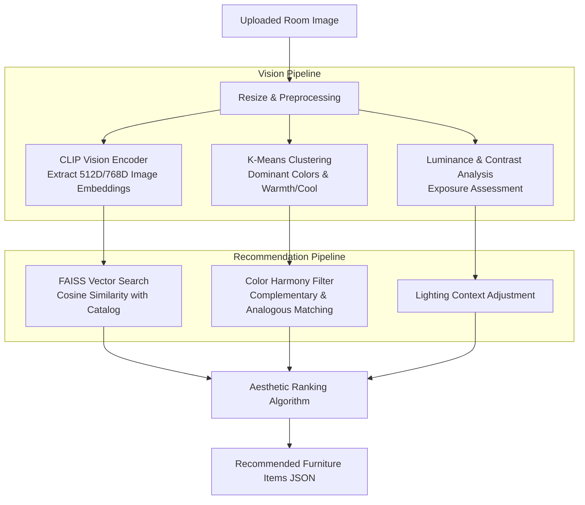

# 🧠 Mirage AI Service — Room Analysis & Furniture Recommender

A high-performance computer vision and deep learning microservice built with **FastAPI**, **PyTorch**, and **OpenAI CLIP**, providing intelligent interior scene analysis and aesthetic furniture recommendations.

---

## 🛠️ Architecture & Technologies

* **Framework:** FastAPI (Uvicorn ASGI)
* **Vision-Language Model:** OpenAI CLIP (`ViT-B/32` or `ViT-L/14`)
* **Similarity Search:** FAISS (Facebook AI Similarity Search - CPU/GPU)
* **Color Harmonization:** K-Means Color Clustering & CIE Lab delta-E color distance
* **Image Processing:** OpenCV, Pillow, Scikit-learn, NumPy

---

## 🔍 How the Pipeline Works

When a static room photograph is submitted to `/analyze`:



1. **Color Extraction:** K-Means clustering extracts the top dominant colors, categorical classification (neutral, warm, cool), and saturation levels.
2. **Lighting Analysis:** Computes average luminance, RMS contrast, and determines scene brightness level.
3. **Multimodal CLIP Understanding:** Maps the visual image into CLIP's joint multimodal embedding space to classify room typology (e.g., modern living room, minimalist bedroom) and dominant textures (wood, fabric, metal).
4. **FAISS Similarity Search:** Queries the pre-indexed furniture catalog embeddings to return ranked candidate matches in **< 2 seconds**.

---

## 🚀 Setup & Execution

### 1. Create Environment
```bash
python -m venv venv

# Windows
.\venv\Scripts\activate

# Linux / macOS
source venv/bin/activate
```

### 2. Install Requirements
```bash
pip install -r requirements.txt
```

### 3. Start the Server
```bash
uvicorn backend.main:app --host 0.0.0.0 --port 8001 --reload
```

* **API Docs (Swagger UI):** `http://localhost:8001/docs`
* **Test Interface:** `http://localhost:8001/` (serves the integrated demo web page)

---

## 📡 API Reference

### `POST /analyze`
Uploads a room image to receive detailed interior analytics and furniture matches.

* **Content-Type:** `multipart/form-data`
* **Form Field:** `file` (Image binary: JPG, PNG, WEBP)

#### Example Response:
```json
{
  "status": "success",
  "room_analysis": {
    "style": "modern minimalist interior with clean lines",
    "color_palette": "neutral room with beige and gray tones",
    "lighting": "bright naturally lit room"
  },
  "dominant_colors": {
    "colors": [
      {"rgb": [245, 235, 220], "hex": "#F5EBDC", "name": "beige", "percentage": 35.2},
      {"rgb": [180, 170, 160], "hex": "#B4AAA0", "name": "taupe", "percentage": 22.1}
    ],
    "temperature": "neutral",
    "brightness_level": "bright"
  },
  "lighting_analysis": {
    "brightness_value": 156.4,
    "brightness_level": "bright",
    "exposure": "well-exposed"
  },
  "recommendations": [
    {
      "id": 14,
      "name": "Nordic Minimalist Armchair",
      "category": "Seating",
      "similarity_score": 0.892,
      "glb_model_url": "http://backend-server/storage/models/nordic_chair.glb"
    }
  ]
}
```

For complete integration code with Flutter, see [FLUTTER_INTEGRATION_GUIDE.md](FLUTTER_INTEGRATION_GUIDE.md).
